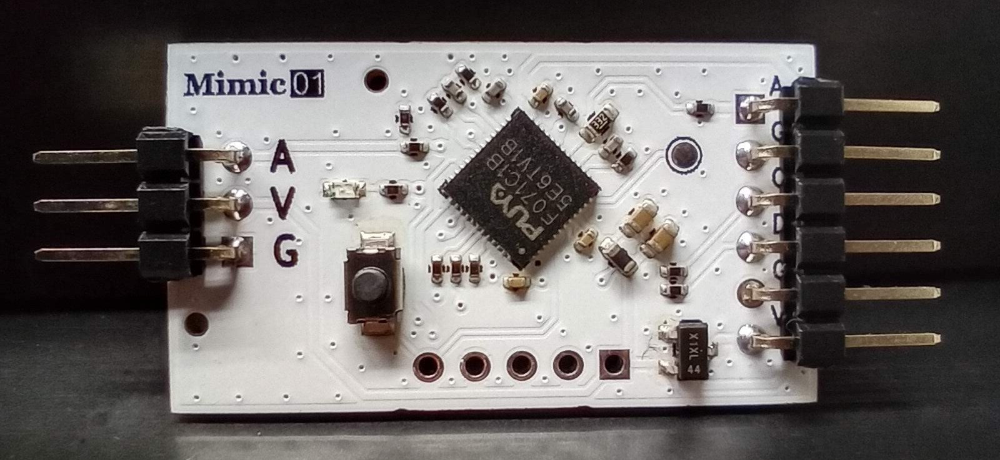
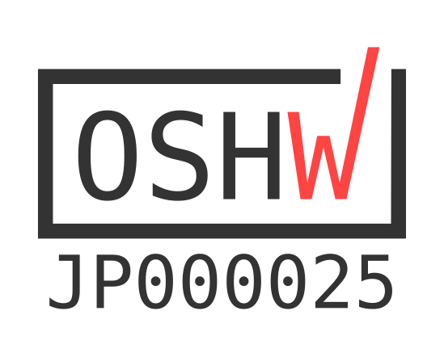
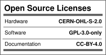
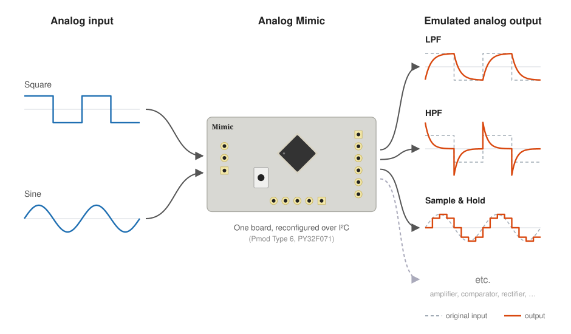
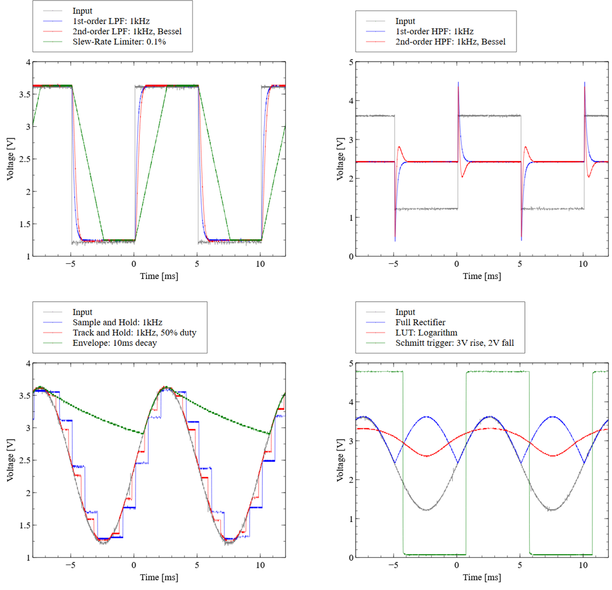
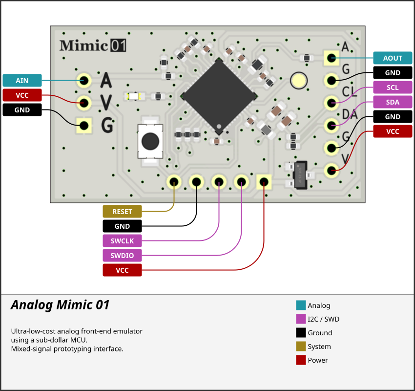
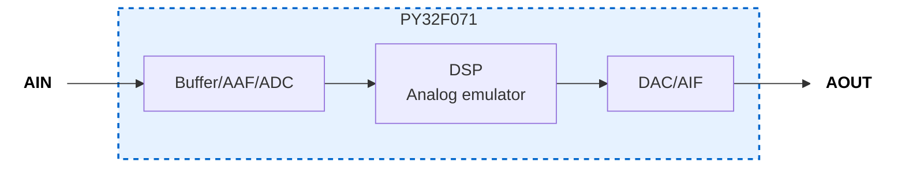

# Analog Mimic (analog-mimic)

[日本語](README.md)

## Overview

Analog Mimic is a drop-in, programmable analog front-end (AFE) module powered by a robust "MCU + DSP" architecture. It is designed to bring software-defined flexibility to physical analog boundaries.

**Key Features:**
* **Versatile Emulation:** Physically mimics diverse analog circuits: amplifiers, filters, integrators, comparators, rectifiers, oscillators, modulators, log amplifiers and more (see [What It Can Do](#what-it-can-do)).
* **Instant Reconfiguration:** Fully reconfigurable on the fly with a single I²C command.
* **Drop-in Ready:** Designed to be easily integrated into your existing hardware prototyping workflow.

## Why This Exists

Learning analog circuits requires three separate competencies: designing a
circuit, building it, and evaluating how it behaves. These are serial — a
learner must succeed at all three before observing any behaviour at all.
Failures at the build stage are frequently unrelated to understanding:
a cold solder joint, a misread colour code, stray capacitance on a
breadboard. The learner receives no feedback about the circuit, only about
their assembly technique.

Circuit simulators remove this barrier, but replace physical signals with
screen output. The learner never connects a probe, never sees noise, never
observes what happens when a real source drives a real load.

Analog Mimic decouples evaluation from design and construction while keeping
the signals physical. A learner connects a probe to a real output, observes a
real waveform on a real oscilloscope, and drives real downstream circuitry —
without first designing or building the emulated circuit. Changing the
emulated topology or its parameters is an I²C write from a host
microcontroller, so a single board covers filters, comparators, rectifiers,
and non-linear blocks. Comparing a Sallen-Key response against a Schmitt
trigger becomes a parameter change rather than a rewiring exercise.

Because reconfiguration is driven from the digital side, the module also
provides an entry path for learners who arrived through Arduino-style digital
prototyping and have not yet worked with analog signal chains.

## What It Can Do

One module emulates one of the following circuits at a time; the input and the output are real analog voltages (200 kHz sampling, 12-bit ADC and DAC). Settings are given in physical units (V, Hz, µs) through the Arduino library. The lectures show each circuit on real hardware.

| Family | Circuits | Lectures |
|---|---|---|
| Amplifiers | Voltage follower (bypass), inverting / non-inverting amplifier (programmable gain) | [0](https://github.com/tkgktyk/analog-mimic-examples/tree/main/lectures/00_intro), [1](https://github.com/tkgktyk/analog-mimic-examples/tree/main/lectures/01_amplifier) |
| Filters | 1st-order LPF / HPF / APF; 2nd-order LPF / HPF (Bessel, Butterworth, Chebyshev), BPF, notch, APF | [2](https://github.com/tkgktyk/analog-mimic-examples/tree/main/lectures/02_filter1st), [3](https://github.com/tkgktyk/analog-mimic-examples/tree/main/lectures/03_filter2nd) |
| Time | Integrator, differentiator, sample & hold, track & hold, slew rate limiter, delay line | [4](https://github.com/tkgktyk/analog-mimic-examples/tree/main/lectures/04_time) |
| Nonlinear | Schmitt trigger and window comparator (digital output), hard / soft clipper, dead zone, half / full-wave rectifier, envelope follower, peak hold | [5](https://github.com/tkgktyk/analog-mimic-examples/tree/main/lectures/05_nonlinear) |
| Sources and modulators | Constant voltage, oscillator (sine, triangle, square, sawtooth), VCO, white / pink noise, AM / ring modulator, PWM modulator, V/F converter | [6](https://github.com/tkgktyk/analog-mimic-examples/tree/main/lectures/06_source) |
| Computation | Logarithmic / antilogarithmic amplifier, squarer, square rooter, true RMS converter | [7](https://github.com/tkgktyk/analog-mimic-examples/tree/main/lectures/07_math) |

Common settings for every mode: the reference voltage (Vref, the signal ground), an output offset, output inversion, and decimation (a lower processing rate for slow signals). Several modules can be chained, each emulating one block.

## Getting Started

What you need:
* An Analog Mimic module (MIMIC01).
* A host microcontroller with I²C, for example an Arduino. The [lectures](https://github.com/tkgktyk/analog-mimic-examples) use an **Arduino UNO R4 Minima**, which also serves as the signal generator (DAC) and a two-channel oscilloscope.
* The Arduino library **AnalogMimic** (Arduino IDE: *Tools -> Manage Libraries*, search for `AnalogMimic`). Its README describes the wiring, the API and the examples: [tkgktyk/analog-mimic-arduino](https://github.com/tkgktyk/analog-mimic-arduino).

Supply the module from **VCC**, from the same supply as the host (5 V on an Arduino UNO); the analog range follows the supply (ratiometric). The I²C pull-up resistors are on the module.

Where to go next:
* **Learn analog circuits:** the lectures (Japanese, Jupyter notebooks), one circuit per lecture, in [analog-mimic-examples](https://github.com/tkgktyk/analog-mimic-examples).
* **Write your own sketch:** the examples of the library (*File -> Examples -> AnalogMimic*).

## Hardware
* **Form Factor:** Pmod-style 6-pin connector with a compact footprint (35.56 mm × 20 mm). SCL, SDA, GND and VCC follow the Pmod Type 6 (I²C) pinout; pins 1 and 2 carry GND and AOUT instead of the optional INT and RESET signals.
* **Analog Input Header:** 3 pins (AIN, V, GND). V is a supply output for a sensor (VCC after the reverse-polarity protection); do not supply the module from it.
* **Signals:** 200 kHz sampling, 12-bit ADC and DAC, ratiometric to VCC; the input and the output range is about 0.1 V to VCC − 0.1 V.
* **On-Chip Integration:** Seamless integration of internal operational amplifier-based input/output buffers, anti-aliasing filters (AAF), and anti-imaging filters (AIF) mapped directly alongside the high-speed processing core.

### I²C Address
Two solder jumpers on the bottom side select the address (read at power-up).

| A1 | A0 | Address |
|---|---|---|
| open | open | 0x40 |
| open | closed | 0x41 |
| closed | open | 0x42 |
| closed | closed | 0x43 |

## Open Source Hardware Certification

Analog Mimic is certified as open source hardware by the [Open Source Hardware Association (OSHWA)](https://certification.oshwa.org/).
Each hardware revision is certified separately; firmware updates do not change the board revision or its certification.

| Board | OSHWA UID | Certified | Hardware files | Notes |
|-------|-----------|-----------|----------------|-------|
| Mimic 01 | [JP000025](https://certification.oshwa.org/jp000025.html) | 2026-10-29 | [`hardware/assembly/mimic01_20260522/`](hardware/assembly/mimic01_20260522/) | Initial release |

Licenses: hardware under CERN-OHL-S-2.0, firmware under GPL-3.0-only, documentation under CC BY 4.0. See [LICENSE](LICENSE) for details.

## For Developers

The rest of this document is for developers of the firmware and the hardware.

* [docs/firmware_reference.md](docs/firmware_reference.md): the sampling pipeline, the fixed-point arithmetic, the I²C register map and every mode. `firmware/core/Inc/mimic_registers.h` is the authoritative definition of the interface, shared with the Arduino library.
* New modes are first released as experimental ([docs/experimental_modes.md](docs/experimental_modes.md), `AnalogMimicExperimental.h` in the library) and become regular modes once they are verified on hardware by a lecture or a library example.

### Measuring Output Timing

This firmware accompanies a manuscript on output timing determinism,
prepared for submission to IEEJ Transactions on Electronics, Information
and Systems. The device and the signal chain described in Sect. 3 of that
manuscript correspond to the `mimic01` board in this repository.

#### Toolchain

* Arm GNU Toolchain 15.2.Rel1 (`arm-none-eabi-gcc` 15.2.1 20251203)
* GNU Make

All commands below are issued from `firmware/targets/mimic0x/`. If the
toolchain is not on `PATH`, pass its location explicitly:

    make GCC_PATH="/path/to/arm-gnu-toolchain/bin"

#### Issuing agent (build-time)

The agent that writes the output register is selected at compile time
through `ENGINE`, which defines `MIMIC_ENGINE_DMA` or `MIMIC_ENGINE_CPU`.

| Agent | Normal service | Measurement build      |
|-------|----------------|------------------------|
| DMA   | `make`         | `make dac`             |
| CPU   | `make cpu`     | `make ENGINE=CPU dac`  |

Each build writes to its own tree under `build/`, so the four coexist:
`MIMIC01`, `MIMIC01_cpu`, `MIMIC01_dacpulse`, `MIMIC01_cpu_dacpulse`.

Note that `ENGINE` must be given on the command line when combined with
`dac`. The `cpu` target sets `ENGINE` only for its own recursive
invocation, so `make cpu dac` builds the DMA variant.

#### Output route (run-time)

The route is **not** a build option. The host selects the analog route
(DAC + AIF) or the digital route (GPIO) over I²C as part of a
reconfiguration, together with the topology and the coefficients. The four
rows of Table 1 are therefore two builds, each exercised on both routes.

#### Output timing build

`make dac` defines `ENABLE_DAC_PULSE`. The DSP keeps running as usual, but
its result is replaced by a full-scale square wave (0 and 4095 on alternate
DSP outputs), so that every period carries a transition of known polarity.
The sampling reference clock (100 kHz, toggling at every sample) is driven
on the PA2 test pad. Use it to measure the output timing against the
sampling clock. A firmware built without it emulates the selected circuit
as usual and leaves PA2 unused.

The distributions of Sect. 4 of the manuscript were taken with this build
of the firmware tagged `paper-v1`.

#### Dependency

`firmware/lib/PY32F071_Firmware` is
[OpenPuya/PY32F071_Firmware](https://github.com/OpenPuya/PY32F071_Firmware)
v1.0.5 (`73e384cd`), distributed under BSD-3-Clause. It is included as a
git submodule; clone with git clone --recursive
(or run git submodule update --init).

#### Host side

The host is not included here. It only issues I²C writes to
select the emulation mode, the output route, and the coefficients. The
register map is defined in `firmware/core/Inc/mimic_registers.h`, which is
the authoritative description of the interface; any I²C master will do.

The measurements of Sect. 4 were taken with an Arduino host performing a
single reconfiguration before each acquisition: a second-order biquad
filter on the analog route, and a comparator mode on the digital route.
