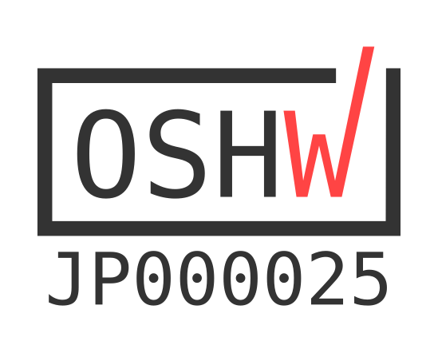
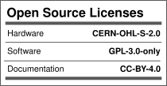
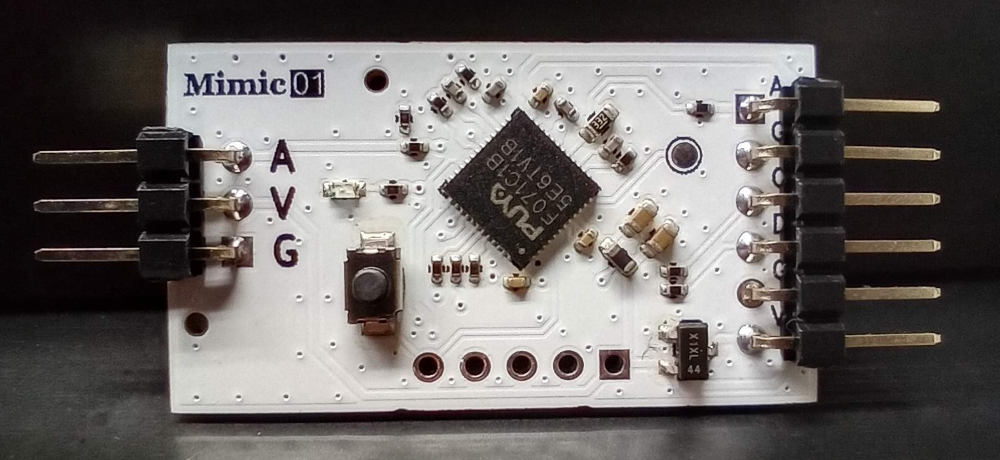
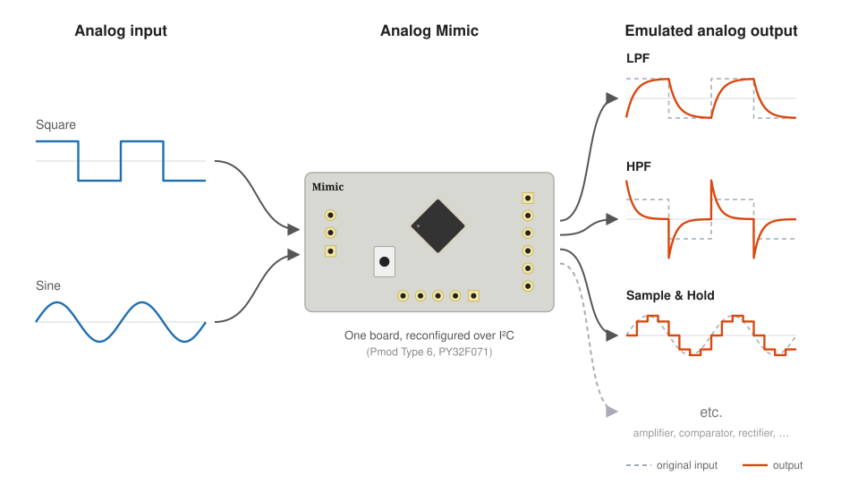
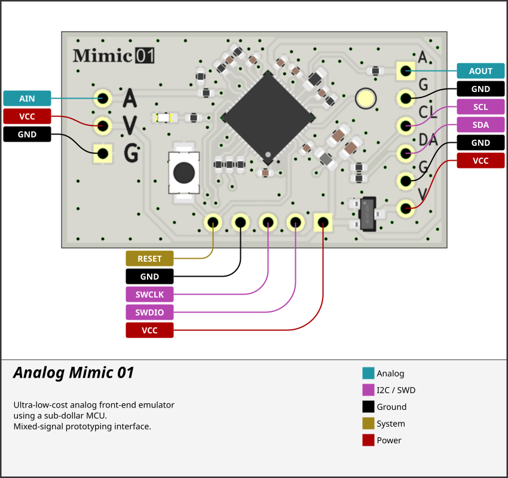
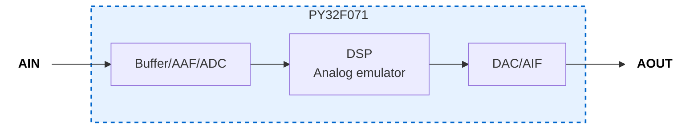
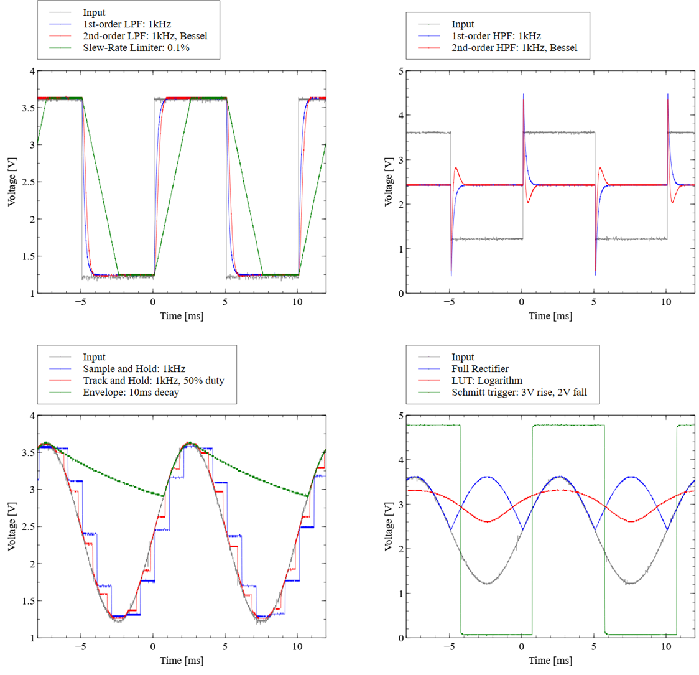

# Analog Mimic (analog-mimic)

## Overview
Analog Mimic is a drop-in, programmable analog front-end (AFE) module powered by a robust "MCU + DSP" architecture. It is designed to bring software-defined flexibility to physical analog boundaries.

**Key Features:**
* **Versatile Emulation:** Physically mimics diverse analog circuits (e.g., filters, amplifiers, comparators).
* **Instant Reconfiguration:** Fully reconfigurable on the fly with a single I²C command.
* **Drop-in Ready:** Designed to be easily integrated into your existing hardware prototyping workflow.

## Why This Exists

Learning analog circuits requires three separate competencies: designing a
circuit, building it, and evaluating how it behaves. These are serial — a
learner must succeed at all three before observing any behaviour at all.
Failures at the build stage are frequently unrelated to understanding:
a cold solder joint, a misread colour code, stray capacitance on a
breadboard. The learner receives no feedback about the circuit, only about
their assembly technique.

Circuit simulators remove this barrier, but replace physical signals with
screen output. The learner never connects a probe, never sees noise, never
observes what happens when a real source drives a real load.

Analog Mimic decouples evaluation from design and construction while keeping
the signals physical. A learner connects a probe to a real output, observes a
real waveform on a real oscilloscope, and drives real downstream circuitry —
without first designing or building the emulated circuit. Changing the
emulated topology or its parameters is an I²C write from a host
microcontroller, so a single board covers filters, comparators, rectifiers,
and non-linear blocks. Comparing a Sallen-Key response against a Schmitt
trigger becomes a parameter change rather than a rewiring exercise.

Because reconfiguration is driven from the digital side, the module also
provides an entry path for learners who arrived through Arduino-style digital
prototyping and have not yet worked with analog signal chains.

## Hardware Concept
* **Form Factor:** Pmod-style 6-pin connector with a compact footprint (35.56 mm × 20 mm). SCL, SDA, GND and VCC follow the Pmod Type 6 (I²C) pinout; pins 1 and 2 carry GND and AOUT instead of the optional INT and RESET signals.
* **On-Chip Integration:** Seamless integration of internal operational amplifier-based input/output buffers, anti-aliasing filters (AAF), and anti-imaging filters (AIF) mapped directly alongside the high-speed processing core.

### I²C Address
Two solder jumpers on the bottom side select the address (read at power-up).

| A1 | A0 | Address |
|---|---|---|
| open | open | 0x40 |
| open | closed | 0x41 |
| closed | open | 0x42 |
| closed | closed | 0x43 |

## Software Ecosystem
To lower the barrier to entry for real-time digital signal processing, we provide a dedicated **C++ library for Arduino**. 
* **Zero-Hassle Control:** Fixed-point arithmetic and low-level I²C register maps are completely abstracted away.
* **Intuitive High-Level API:** Users can dynamically switch emulation modes and fine-tune physical parameters—such as cutoff frequencies, amplifier gains, or envelope release times—by simply passing variables into straightforward function calls.

*For details on the inner workings and the register map, see [firmware_reference.md](docs/firmware_reference.md). The Arduino library is [AnalogMimic](https://github.com/tkgktyk/analog-mimic-arduino).*

## DEMO: Analog Emulation

## Reproducing the Measurements in the Manuscript

This firmware accompanies a manuscript on output timing determinism,
prepared for submission to IEEJ Transactions on Electronics, Information
and Systems. The device and the signal chain described in Sect. 3 of that
manuscript correspond to the `mimic01` board in this repository.

### Toolchain

* Arm GNU Toolchain 15.2.Rel1 (`arm-none-eabi-gcc` 15.2.1 20251203)
* GNU Make

All commands below are issued from `firmware/targets/mimic0x/`. If the
toolchain is not on `PATH`, pass its location explicitly:

    make GCC_PATH="/path/to/arm-gnu-toolchain/bin"

### Issuing agent (build-time)

The agent that writes the output register is selected at compile time
through `ENGINE`, which defines `MIMIC_ENGINE_DMA` or `MIMIC_ENGINE_CPU`.

| Agent | Normal service | Measurement build      |
|-------|----------------|------------------------|
| DMA   | `make`         | `make dac`             |
| CPU   | `make cpu`     | `make ENGINE=CPU dac`  |

Each build writes to its own tree under `build/`, so the four coexist:
`MIMIC01`, `MIMIC01_cpu`, `MIMIC01_dacpulse`, `MIMIC01_cpu_dacpulse`.

Note that `ENGINE` must be given on the command line when combined with
`dac`. The `cpu` target sets `ENGINE` only for its own recursive
invocation, so `make cpu dac` builds the DMA variant.

### Output route (run-time)

The route is **not** a build option. The host selects the analog route
(DAC + AIF) or the digital route (GPIO) over I²C as part of a
reconfiguration, together with the topology and the coefficients. The four
rows of Table 1 are therefore two builds, each exercised on both routes.

### Measurement build

The distributions of Sect. 4 were taken with `ENABLE_DAC_PULSE`, a toggle
that overrides the emulated output so that every period carries a
transition of known polarity. A firmware built without it emulates the
selected circuit as usual and will not reproduce Fig. 4 and Fig. 5.

### Dependency

`firmware/lib/PY32F071_Firmware` is
[OpenPuya/PY32F071_Firmware](https://github.com/OpenPuya/PY32F071_Firmware)
v1.0.5 (`73e384cd`), distributed under BSD-3-Clause. It is included as a
git submodule; clone with git clone --recursive
(or run git submodule update --init).

### Host side

The host is not included here. It only issues I²C writes to
select the emulation mode, the output route, and the coefficients. The
register map is defined in `firmware/core/Inc/mimic_registers.h`, which is
the authoritative description of the interface; any I²C master will do.

The measurements of Sect. 4 were taken with an Arduino host performing a
single reconfiguration before each acquisition: a second-order biquad
filter on the analog route, and a comparator mode on the digital route.

## Open Source Hardware Certification

Analog Mimic is certified as open source hardware by the [Open Source Hardware Association (OSHWA)](https://certification.oshwa.org/).
Each hardware revision is certified separately; firmware updates do not change the board revision or its certification.

| Board | OSHWA UID | Certified | Hardware files | Notes |
|-------|-----------|-----------|----------------|-------|
| Mimic 01 | [JP000025](https://certification.oshwa.org/jp000025.html) | 2026-10-29 | [`hardware/assembly/mimic01_20260522/`](hardware/assembly/mimic01_20260522/) | Initial release |

Licenses: hardware under CERN-OHL-S-2.0, firmware under GPL-3.0-only, documentation under CC BY 4.0. See [LICENSE](LICENSE) for details.
