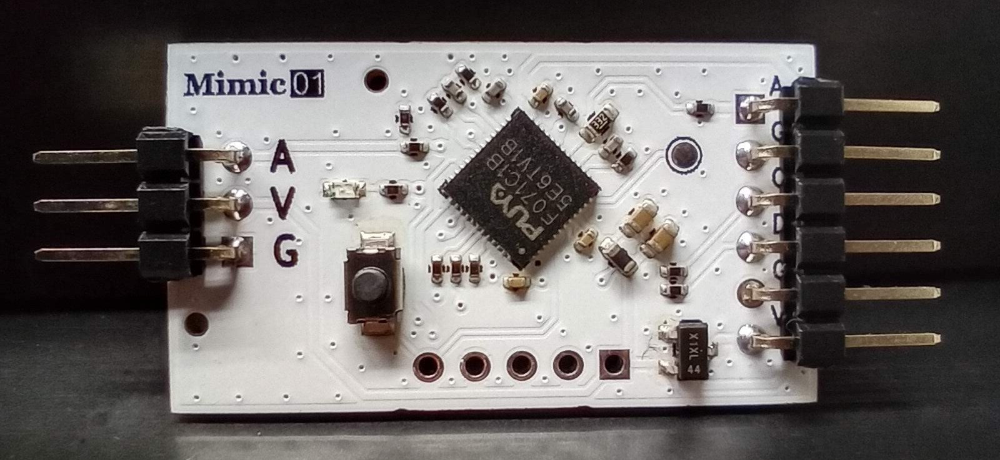
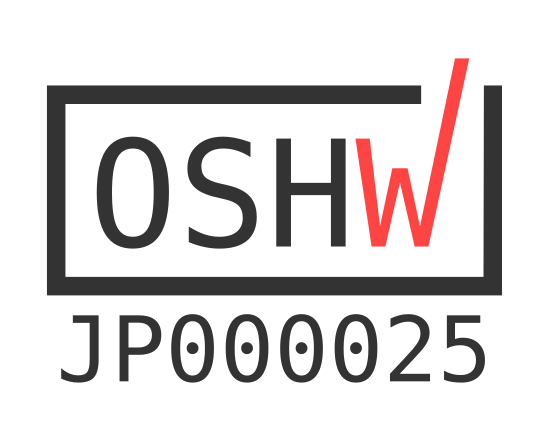
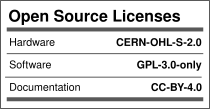
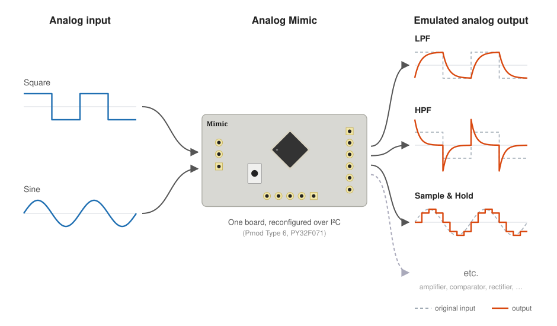
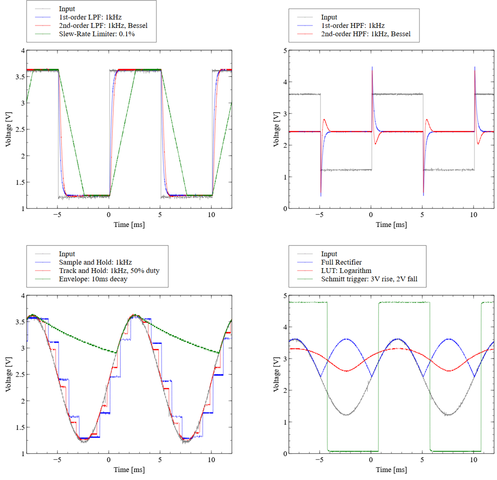
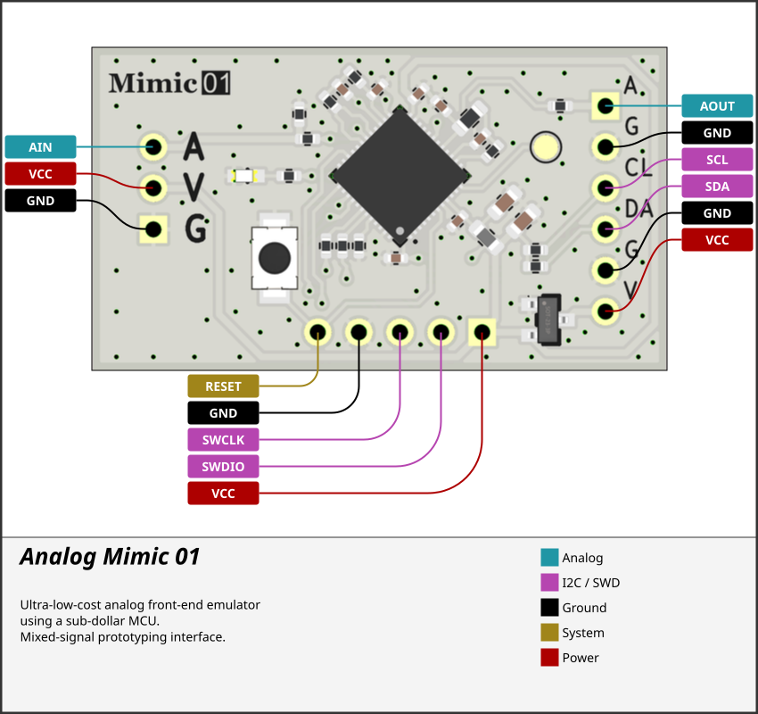
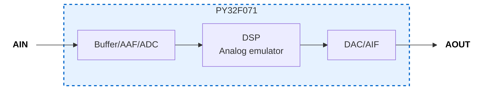

# Analog Mimic(analog-mimic)

[English](README.en.md)

## 概要

Analog Mimic は、プログラムで中身を入れかえられるアナログ回路のモジュールです。マイコンと DSP で、増幅器やフィルタ、比較器などのアナログ回路の動きを、本物の電圧の入出力のまま再現します。

- **いろいろな回路になる**:増幅器、フィルタ、積分器、比較器、整流回路、発振器、変調器、対数アンプなど(下の「[できること](#できること)」)。
- **すぐに切りかわる**:I²C の命令 1 つで、回路の種類も定数も、動かしたまま変えられます。
- **そのままつなげる**:ブレッドボードやいつもの試作の回路に、部品の 1 つとして組みこめます。

## なぜ作ったか

アナログ回路を学ぶには、回路を設計する、組み立てる、動きを確かめる、の 3 つが必要です。この 3 つは順番につながっていて、全部うまくいかないと、回路の動きを 1 つも見ることができません。組み立てでつまずく原因は、はんだ付けの不良、抵抗の色の読みまちがい、ブレッドボードの浮遊容量など、回路の理解とは関係のないことがほとんどです。学ぶ人に返ってくるのは、回路についてではなく、組み立ての腕についての手がかりだけです。

回路シミュレータを使えばこの壁はなくなりますが、本物の信号が画面の表示に置きかわります。プローブを当てることも、雑音を見ることも、本物の信号源が本物の負荷を動かすところを見ることもありません。

Analog Mimic は、信号を本物のままにして、「動きを確かめる」ことを、設計と組み立てから切り離します。再現した回路を設計したり組み立てたりしなくても、本物の出力にプローブを当て、本物のオシロスコープで本物の波形を見て、その先の本物の回路を動かせます。回路の形や定数を変えるのは、マイコンからの I²C の書きこみだけなので、1 枚の基板で、フィルタ、比較器、整流回路、非線形の回路まで扱えます。サレン・キーのフィルタとシュミットトリガを比べるのに、配線を組みかえる必要はありません。

設定はデジタルの側から行うので、Arduino などのデジタルの工作から入って、まだアナログの信号を扱ったことのない人の入り口にもなります。

## できること

1 台のモジュールが、次の回路のどれか 1 つになります。入力と出力は本物のアナログの電圧です(サンプリング 200 kHz、ADC と DAC は 12 ビット)。設定は、Arduino のライブラリから、V、Hz、µs などの物理の単位で行います。それぞれの回路を実機で確かめる講義があります(右の列)。

| 種類 | 回路 | 講義 |
|---|---|---|
| 増幅 | ボルテージフォロワ(素通し)、反転増幅・非反転増幅(ゲインを設定できる) | [0](https://github.com/tkgktyk/analog-mimic-examples/tree/main/lectures/00_intro)、[1](https://github.com/tkgktyk/analog-mimic-examples/tree/main/lectures/01_amplifier) |
| フィルタ | 1 次の LPF / HPF / APF、2 次の LPF / HPF(ベッセル、バターワース、チェビシェフ)、BPF、ノッチ、APF | [2](https://github.com/tkgktyk/analog-mimic-examples/tree/main/lectures/02_filter1st)、[3](https://github.com/tkgktyk/analog-mimic-examples/tree/main/lectures/03_filter2nd) |
| 時間の処理 | 積分器、微分器、サンプル&ホールド、トラック&ホールド、スルーレート制限、遅延 | [4](https://github.com/tkgktyk/analog-mimic-examples/tree/main/lectures/04_time) |
| 非線形 | シュミットトリガとウィンドウ比較器(デジタル出力)、ハード / ソフトクリッパ、不感帯、半波 / 全波整流、エンベロープ検出、ピークホールド | [5](https://github.com/tkgktyk/analog-mimic-examples/tree/main/lectures/05_nonlinear) |
| 信号源と変調 | 定電圧、発振器(正弦波、三角波、方形波、のこぎり波)、VCO、白色 / ピンク雑音、AM / リング変調、PWM 変調、V/F 変換 | [6](https://github.com/tkgktyk/analog-mimic-examples/tree/main/lectures/06_source) |
| 演算 | 対数 / 逆対数アンプ、二乗回路、平方根回路、実効値(True RMS) | [7](https://github.com/tkgktyk/analog-mimic-examples/tree/main/lectures/07_math) |

どのモードにも共通の設定として、基準電圧(Vref、信号のグランド)、出力のオフセット、出力の反転、デシメーション(遅い信号のために処理をゆっくりにする)があります。何台かをつないで、1 台に 1 つずつブロックを受け持たせることもできます。

## はじめかた

必要なもの:
- Analog Mimic のモジュール(MIMIC01)
- I²C の使えるマイコン(Arduino など)。[講義](https://github.com/tkgktyk/analog-mimic-examples)では **Arduino UNO R4 Minima** を使い、信号発生器(DAC)と 2 チャンネルのオシロスコープにもします。
- Arduino のライブラリ **AnalogMimic**(Arduino IDE の「ツール」→「ライブラリを管理」で `AnalogMimic` を検索)。配線、API、例は、ライブラリの README(英語)にあります:[tkgktyk/analog-mimic-arduino](https://github.com/tkgktyk/analog-mimic-arduino)

モジュールの電源は **VCC** から、マイコンと同じ電源で入れます(Arduino UNO なら 5 V)。アナログの範囲は電源の電圧に比例します(レシオメトリック)。I²C のプルアップ抵抗はモジュールについています。

次に読むもの:
- **アナログ回路を学ぶ**:[analog-mimic-examples](https://github.com/tkgktyk/analog-mimic-examples) の講義(日本語、Jupyter のノートブック)。1 回に 1 つの回路を、実機で測りながら学びます。
- **自分でスケッチを書く**:ライブラリの例(Arduino IDE の「ファイル」→「スケッチ例」→「AnalogMimic」)。

## ハードウェア

- **形と大きさ**:Pmod 形の 6 ピンのコネクタ、35.56 mm × 20 mm。SCL、SDA、GND、VCC は Pmod Type 6(I²C)の並びと同じで、1 番と 2 番のピンは、INT と RESET の代わりに GND と AOUT です。
- **アナログ入力のヘッダ**:3 ピン(AIN、V、GND)。V はセンサー用の電源の出力(逆接続の保護を通ったあとの VCC)で、ここからモジュールに電源を入れてはいけません。
- **信号**:サンプリング 200 kHz、ADC と DAC は 12 ビットで、VCC に比例します。入力と出力の範囲は、およそ 0.1 V〜VCC − 0.1 V です。
- **中身**:入力と出力のオペアンプのバッファ、折り返しを防ぐフィルタ(AAF)、出力の階段をならすフィルタ(AIF)を、処理をするマイコンのまわりに組みこんでいます。

### I²C のアドレス
裏面の 2 つのはんだジャンパーでアドレスを選びます(電源を入れたときに読みます)。

| A1 | A0 | アドレス |
|---|---|---|
| 開放 | 開放 | 0x40 |
| 開放 | 短絡 | 0x41 |
| 短絡 | 開放 | 0x42 |
| 短絡 | 短絡 | 0x43 |

## オープンソースハードウェアの認証

Analog Mimic は、[Open Source Hardware Association(OSHWA)](https://certification.oshwa.org/) にオープンソースハードウェアとして認証されています。認証は基板の版ごとで、ファームウェアを更新しても、基板の版と認証は変わりません。

| 基板 | OSHWA UID | 認証日 | ハードウェアのファイル | 備考 |
|-------|-----------|-----------|----------------|-------|
| Mimic 01 | [JP000025](https://certification.oshwa.org/jp000025.html) | 2026-10-29 | [`hardware/assembly/mimic01_20260522/`](hardware/assembly/mimic01_20260522/) | 初版 |

ライセンス:ハードウェアは CERN-OHL-S-2.0、ファームウェアは GPL-3.0-only、ドキュメントは CC BY 4.0 です。くわしくは [LICENSE](LICENSE) を見てください。

## 開発者向け

ファームウェアのしくみ、レジスタの一覧、ビルドの方法、出力のタイミングの測定は、英語版の [For Developers](README.en.md#for-developers) にあります。
