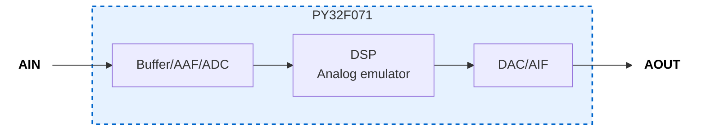

# Analog Mimic (analog-mimic)

## Overview
Analog Mimic is a drop-in, programmable analog front-end (AFE) module powered by a robust "MCU + DSP" architecture. It is designed to bring software-defined flexibility to physical analog boundaries.

**Key Features:**
* **Versatile Emulation:** Physically mimics diverse analog circuits (e.g., filters, amplifiers, comparators).
* **Instant Reconfiguration:** Fully reconfigurable on the fly with a single I²C command.
* **Drop-in Ready:** Designed to be easily integrated into your existing hardware prototyping workflow.

<!-- ## Underlying Technology
**Analog Mimic is powered by OtoHA.**

OtoHA (Optimization toward Hardware-deterministic Architecture) is the foundational framework established in our IEEE ESL paper: *"Sub-Clock Hardware-Deterministic Architecture for Phase-Accurate Analog Emulation on Resource-Constrained MCUs"*. 

By isolating the critical execution path and eliminating architectural timing penalties, OtoHA ensures strict time-invariance and hardware-like precision, allowing standard microcontrollers to operate as strictly deterministic mixed-signal blocks. -->

## Why This Exists

Learning analog circuits requires three separate competencies: designing a
circuit, building it, and evaluating how it behaves. These are serial — a
learner must succeed at all three before observing any behaviour at all.
Failures at the build stage are frequently unrelated to understanding:
a cold solder joint, a misread colour code, stray capacitance on a
breadboard. The learner receives no feedback about the circuit, only about
their assembly technique.

Circuit simulators remove this barrier, but replace physical signals with
screen output. The learner never connects a probe, never sees noise, never
observes what happens when a real source drives a real load.

Analog Mimic decouples evaluation from design and construction while keeping
the signals physical. A learner connects a probe to a real output, observes a
real waveform on a real oscilloscope, and drives real downstream circuitry —
without first designing or building the emulated circuit. Changing the
emulated topology or its parameters is an I²C write from a host
microcontroller, so a single board covers filters, comparators, rectifiers,
and non-linear blocks. Comparing a Sallen-Key response against a Schmitt
trigger becomes a parameter change rather than a rewiring exercise.

Because reconfiguration is driven from the digital side, the module also
provides an entry path for learners who arrived through Arduino-style digital
prototyping and have not yet worked with analog signal chains.

## Hardware Concept
* **Form Factor:** Pmod Type 6 (I²C) compatible layout with a compact footprint (35.56 mm × 20 mm).
* **On-Chip Integration:** Seamless integration of internal operational amplifier-based input/output buffers, anti-aliasing filters (AAF), and anti-imaging filters (AIF) mapped directly alongside the high-speed processing core.

## Software Ecosystem
To lower the barrier to entry for real-time digital signal processing, we provide a dedicated **C++ library for Arduino**. 
* **Zero-Hassle Control:** Complex Q15 fixed-point arithmetic and low-level I²C register maps are completely abstracted away.
* **Intuitive High-Level API:** Users can dynamically switch emulation modes and fine-tune physical parameters—such as cutoff frequencies, amplifier gains, or envelope release times—by simply passing variables into straightforward function calls.

*For comprehensive details on the inner workings, execution framework, and API configurations, please refer to [firmware_reference.md](docs/firmware_reference.md) and the Doxygen-annotated [Mimic.h](software/Mimic/src/Mimic.h).*

## DEMO: Analog Emulation

